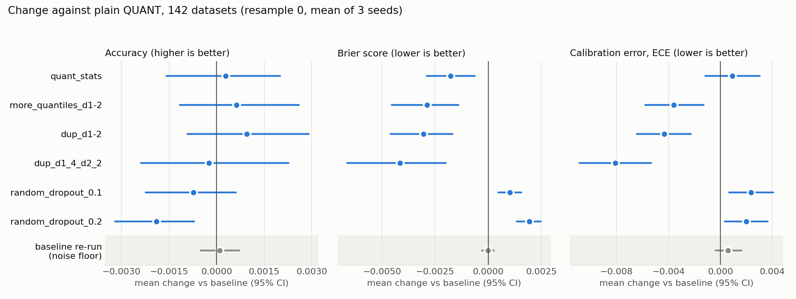
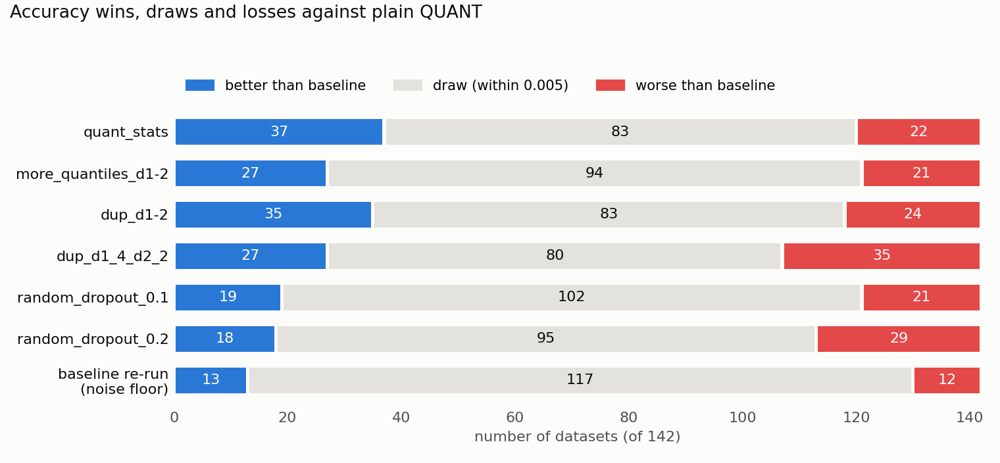

# Results report: QUANT variants on 142 datasets

Date: 12 November 2026. Covers every completed run in `results/`.

## 1. Summary

We tested six changes to QUANT against the plain method on 142 UCR datasets.

- **No variant improves accuracy.** Every variant is within 0.002 of the baseline's mean accuracy (0.8457), and no gain is statistically significant.
- **Giving more weight to the largest intervals improves the predicted probabilities.** Duplicating their features, or extracting more quantiles from them, gives significantly better Brier score and calibration error at no cost in accuracy.
- **More quantiles behaves like duplication.** `more_quantiles_d1-2` and `dup_d1-2` have the same feature count and nearly the same results on every metric.
- **Random feature dropout only hurts.** Dropping 20% of features is significantly worse on every metric.
- **Best overall: `dup_d1-2`, with `more_quantiles_d1-2` level with it in practice.** Both match the baseline on accuracy and have clearly better probabilities. `quant_stats` is third.
- **One real accuracy effect was found.** The large-interval variants help strongly on the Pig datasets (up to +11 points). This is the most promising lead.

These results come from a single train/test split (resample 0). Section 10 lists what is needed before making firm claims.

## 2. What was compared

All methods use the same classifier: ExtraTrees with 200 trees, `max_features=0.1` and the entropy criterion. Only the features differ.

| Method | What it changes | Features vs baseline |
|---|---|---|
| `quant_base` | Plain QUANT (the reference) | ×1.00 |
| `dup_d1-2` | Feature columns from interval depths 1 and 2 appear twice | ×1.23 |
| `dup_d1_4_d2_2` | Depth 1 columns appear four times, depth 2 twice | ×1.42 |
| `more_quantiles_d1-2` | Depths 1 and 2 get twice as many quantiles (m/2 instead of m/4) | ×1.23 |
| `random_dropout_0.1` | A random 10% of feature columns is removed | ×0.90 |
| `random_dropout_0.2` | A random 20% of feature columns is removed | ×0.80 |
| `quant_stats` | Standard deviation and slope added for every interval | ×1.42 |

"Features vs baseline" is the average over datasets of each dataset's feature count divided by the baseline's.

Depth 1 is the whole series and depth 2 is its two halves, so three of the variants put more weight on the largest intervals. Duplication and dropout add no new information. `more_quantiles_d1-2` and `quant_stats` do.

### Protocol

- **Data:** 142 datasets, resample 0 (the original train/test split).
- **Repeats:** 3 classifier seeds (7, 11, 42) per dataset. Each dataset's score is the mean of the 3 seeds.
- **Total:** 426 runs per method.
- **Win / draw / loss:** counted per dataset. A difference of 0.005 or less is a draw.
- **Significance:** Wilcoxon signed-rank test over the 142 datasets, with Holm correction across the six variants.
- **Confidence intervals:** 95% bootstrap over datasets (10,000 resamples).

### Metrics

| Metric | Measures | Better |
|---|---|---|
| Accuracy | Share of test series classified correctly | Higher |
| Balanced accuracy, macro F1, MCC | Accuracy adjusted for class imbalance | Higher |
| AUC | How well the predicted probabilities rank the classes | Higher |
| Log loss, Brier score | Error of the predicted probabilities | Lower |
| ECE (expected calibration error) | Gap between stated confidence and actual accuracy | Lower |

## 3. How much is noise

The baseline was run twice, on two different machines, with identical settings and seeds. The two runs do not agree exactly, so this comparison shows how large a difference can be without meaning anything.

| Measure | Baseline run 1 vs run 2 |
|---|---|
| Runs with identical accuracy | 193 of 426 |
| Largest difference on a single run | 0.047 |
| Largest difference on a dataset mean (3 seeds) | 0.013 |
| Mean accuracy | 0.8457 vs 0.8458 |
| Win / draw / loss | 13 / 117 / 12 |

Separately, the mean accuracy of a single method moves by up to 0.003 from one seed to the next.

How to read the results in the following sections:

- A difference in mean accuracy below about 0.002 is within noise.
- A win/loss split near 13/12 means nothing.
- A change on one dataset smaller than about 0.015 is not evidence of anything.

## 4. Accuracy



| Method | Mean accuracy | Change | 95% CI | Win / draw / loss | p | p (Holm) | Average rank |
|---|---|---|---|---|---|---|---|
| `quant_base` | 0.8457 | — | — | — | — | — | 3.97 |
| `dup_d1-2` | 0.8466 | +0.0010 | −0.0009 to +0.0030 | 35 / 83 / 24 | 0.33 | 0.95 | 3.86 |
| `more_quantiles_d1-2` | 0.8463 | +0.0006 | −0.0011 to +0.0026 | 27 / 94 / 21 | 0.32 | 0.95 | 3.80 |
| `quant_stats` | 0.8459 | +0.0003 | −0.0016 to +0.0019 | 37 / 83 / 22 | 0.057 | 0.28 | **3.52** |
| `dup_d1_4_d2_2` | 0.8454 | −0.0003 | −0.0024 to +0.0022 | 27 / 80 / 35 | 0.10 | 0.42 | 4.57 |
| `random_dropout_0.1` | 0.8449 | −0.0007 | −0.0022 to +0.0006 | 19 / 102 / 21 | 0.99 | 0.99 | 3.90 |
| `random_dropout_0.2` | 0.8438 | −0.0019 | −0.0032 to −0.0007 | 18 / 95 / 29 | 0.007 | **0.039** | 4.39 |

Average rank is over all seven methods (1 is best, 7 is worst). A Friedman test finds that the seven methods differ as a group (p = 0.0002).



What this shows:

- **`dup_d1-2`** has the highest mean, but the interval includes zero. Its whole gain comes from the Pig datasets (section 7); without them the change is −0.0001.
- **`more_quantiles_d1-2`** follows the same pattern: a small positive mean that comes from the Pig datasets (−0.0002 without them), and a win/loss split (27 to 21) close to the noise floor.
- **`quant_stats`** has the best average rank and the best win/loss split (37 to 22). Its gains are small and frequent, so the mean barely moves. With p = 0.057 before correction, it is the closest to a real accuracy effect, but not established.
- **`dup_d1_4_d2_2`** loses more often than it wins (27 to 35). Four copies of depth 1 is too many.
- **`random_dropout_0.1`** is a draw on 102 datasets. Its split (19 to 21) looks like the noise floor.
- **`random_dropout_0.2`** is the only significant accuracy result, and it is a loss.

The other accuracy-type metrics agree. Balanced accuracy, macro F1 and MCC show the same order, and only `random_dropout_0.2` differs significantly from the baseline (p (Holm) between 0.03 and 0.04 on each). AUC changes by less than 0.001 for every variant.

### Method against method

Accuracy win / draw / loss of the row method against the column method.

| | `quant_base` | `dup_d1-2` | `dup_d1_4_d2_2` | `more_quantiles` | `dropout_0.1` | `dropout_0.2` | `quant_stats` |
|---|---|---|---|---|---|---|---|
| `quant_base` | — | 24/83/35 | 35/80/27 | 21/94/27 | 21/102/19 | 29/95/18 | 22/83/37 |
| `dup_d1-2` | 35/83/24 | — | 31/91/20 | 27/95/20 | 30/91/21 | 36/86/20 | 33/73/36 |
| `dup_d1_4_d2_2` | 27/80/35 | 20/91/31 | — | 20/88/34 | 33/71/38 | 38/72/32 | 29/59/54 |
| `more_quantiles` | 27/94/21 | 20/95/27 | 34/88/20 | — | 33/85/24 | 35/84/23 | 27/82/33 |
| `dropout_0.1` | 19/102/21 | 21/91/30 | 38/71/33 | 24/85/33 | — | 26/97/19 | 17/89/36 |
| `dropout_0.2` | 18/95/29 | 20/86/36 | 32/72/38 | 23/84/35 | 19/97/26 | — | 17/85/40 |
| `quant_stats` | 37/83/22 | 36/73/33 | 54/59/29 | 33/82/27 | 36/89/17 | 40/85/17 | — |

`quant_stats`, `dup_d1-2` and `more_quantiles_d1-2` are level with each other. `quant_stats` beats `dup_d1_4_d2_2` clearly (54 to 29).

## 5. Quality of the predicted probabilities

Here the variants do differ from the baseline. Lower is better for all three metrics, so a negative change is an improvement. Win / draw / loss counts an improvement as a win.

| Method | Brier change | W/D/L | p (Holm) | ECE change | W/D/L | p (Holm) | Log loss change | W/D/L | p (Holm) |
|---|---|---|---|---|---|---|---|---|---|
| `dup_d1-2` | −0.0031 | 38/94/10 | <0.001 | −0.0043 | 58/70/14 | <0.001 | +0.0011 | 54/58/30 | 0.011 |
| `more_quantiles_d1-2` | −0.0029 | 41/88/13 | <0.001 | −0.0036 | 56/66/20 | <0.001 | +0.0026 | 55/57/30 | 0.038 |
| `dup_d1_4_d2_2` | **−0.0042** | 45/77/20 | 0.002 | **−0.0081** | 81/44/17 | <0.001 | **−0.0051** | 70/39/33 | 0.002 |
| `quant_stats` | −0.0018 | 31/97/14 | 0.006 | +0.0009 | 39/65/38 | 0.60 | −0.0014 | 50/55/37 | 0.11 |
| `random_dropout_0.1` | +0.0010 | 7/122/13 | <0.001 | +0.0024 | 19/79/44 | 0.001 | +0.0071 | 21/75/46 | 0.002 |
| `random_dropout_0.2` | +0.0019 | 4/117/21 | <0.001 | +0.0020 | 23/70/49 | <0.001 | +0.0112 | 16/59/67 | <0.001 |
| Baseline re-run (noise) | 0.0000 | 3/137/2 | — | +0.0006 | 13/111/18 | — | +0.0022 | 16/106/20 | — |

Baseline values: Brier 0.2467, ECE 0.1233, log loss 0.5453.

What this shows:

- **More weight on large intervals improves probabilities, and more weight improves them more.** ECE falls by about 0.004 for `dup_d1-2` and `more_quantiles_d1-2`, and by 0.008 with four copies. `dup_d1_4_d2_2` improves ECE on 81 datasets and worsens it on 17.
- **The effect is real but small.** An ECE drop of 0.008 is about 7% of the baseline's 0.123.
- **Log loss is mixed for `dup_d1-2` and `more_quantiles_d1-2`.** Each improves on about 55 datasets and worsens on 30, yet the mean rises slightly because a few datasets get much worse. Log loss punishes confident mistakes heavily, so a few datasets can dominate the mean.
- **`quant_stats` improves Brier score only.** Calibration is unchanged.
- **Dropout worsens all three metrics**, at both rates.

A likely explanation: depth 1 and 2 features summarise the whole series, and giving them more columns makes more trees split on the same broad features. Trees that agree more often produce averaged probabilities that are less extreme. This is a hypothesis; we have not tested it.

## 6. More quantiles compared with duplication

`more_quantiles_d1-2` was meant to add new information where `dup_d1-2` only repeats existing columns. In practice the two behave almost the same.

| | `dup_d1-2` | `more_quantiles_d1-2` |
|---|---|---|
| Features vs baseline | ×1.23 | ×1.23 |
| Accuracy change | +0.0010 | +0.0006 |
| Accuracy change without the Pig datasets | −0.0001 | −0.0002 |
| Brier change | −0.0031 | −0.0029 |
| ECE change | −0.0043 | −0.0036 |
| PigAirwayPressure accuracy (baseline 0.438) | 0.519 | 0.529 |

- Head to head on accuracy, `more_quantiles_d1-2` wins on 20 datasets, draws on 95 and loses on 27.
- The two variants gain and lose on the same datasets: their per-dataset accuracy changes have a correlation of 0.76.

A likely reason: the extra quantiles of a large interval fall between the quantiles already extracted, so they are closely related to them and act much like copies. This suggests the benefit comes from how often the forest sees large-interval features, not from finer detail within them. We have not tested this directly.

## 7. Where accuracy does change: the Pig datasets

The three Pig datasets are the only place where a variant moves accuracy well beyond noise.

| Dataset | `quant_base` | Baseline re-run | `dup_d1-2` | `dup_d1_4_d2_2` | `more_quantiles_d1-2` | `quant_stats` |
|---|---|---|---|---|---|---|
| PigAirwayPressure | 0.438 | 0.442 | 0.519 | **0.551** | 0.529 | 0.433 |
| PigCVP | 0.689 | 0.683 | **0.736** | 0.732 | 0.705 | 0.684 |
| PigArtPressure | 0.944 | 0.946 | 0.958 | **0.960** | 0.958 | 0.947 |

- The gain on PigAirwayPressure is 8 to 9 points for `dup_d1-2` and `more_quantiles_d1-2`, and 11 points with four copies. The baseline re-run differs by only 0.5 points, so this is not noise.
- All three seeds of `dup_d1-2` (0.50 to 0.54) and of `more_quantiles_d1-2` (0.52 to 0.54) are above all three seeds of the baseline (0.43 to 0.45).
- `quant_stats`, which does not favour large intervals, shows no gain here.
- These datasets have long series (2,000 points), many classes (52) and few training cases (104).

This suggests that features from the largest intervals are under-used on long series with many classes. It is worth testing directly on other datasets of this type.

On the remaining datasets, the largest gains and losses for each variant are 2 to 5 points on single datasets, in both directions, and they cancel out. No pattern was found by series length or training-set size.

## 8. Cost

| Method | Features vs baseline | Total fit time | Total predict time |
|---|---|---|---|
| `quant_base` (re-run) | ×1.00 | 246 s | 86 s |
| `more_quantiles_d1-2` | ×1.23 | 288 s | 86 s |
| `dup_d1_4_d2_2` | ×1.42 | 336 s | 84 s |
| `quant_stats` | ×1.42 | 349 s | 148 s |
| `random_dropout_0.1` | ×0.90 | 190 s | 83 s |
| `random_dropout_0.2` | ×0.80 | 194 s | 93 s |

Times are totals over all 426 runs on one machine (10-core ARM laptop). `dup_d1-2` ran on the other machine, where its fit time equalled that machine's baseline (410 s against 405 s).

Treat these as rough. Each method was timed once, with all cores, and the machine was not equally busy during each run. The broad picture is that fit time follows the number of features: about 40% slower for the two largest variants and about 20% faster for dropout. A single-core timing run (`--n-jobs 1`) would give figures that can be compared properly.

## 9. Ranking

| Rank | Method | Accuracy | Probabilities | Verdict |
|---|---|---|---|---|
| 1 | `dup_d1-2` | Same as baseline (highest mean) | Better Brier and ECE | Best overall: nothing lost, probabilities gained |
| 2 | `more_quantiles_d1-2` | Same as baseline | Better Brier and ECE | Level with rank 1 in practice; slightly smaller gains |
| 3 | `quant_stats` | Same as baseline (best rank, most wins) | Better Brier, same ECE | Closest to an accuracy gain; needs more resamples |
| 4 | `dup_d1_4_d2_2` | Same as baseline (more losses than wins) | Best on all three | Choose it only if probabilities matter most |
| 5 | `quant_base` | Reference | Reference | — |
| 6 | `random_dropout_0.1` | Same as baseline | Worse | No benefit |
| 7 | `random_dropout_0.2` | Significantly worse | Worse | Rejected |

If only accuracy counts, ranks 1 to 6 cannot be separated with the current data.

### Why the null results make sense

ExtraTrees already picks a random 10% of features at every split. Duplicating a column only makes it slightly more likely to be picked, and dropping columns removes choices the forest was already skipping most of the time. Neither gives the forest information it did not have. Extra quantiles on large intervals are close to copies of the existing ones (section 6). `quant_stats` adds a different kind of information, and it is the variant that comes closest to an accuracy gain.

## 10. Limitations

- **One split only.** Everything is on resample 0. The QUANT paper reports means over 30 resamples. Effects this small may not hold on other splits.
- **Two machines.** `quant_base` and `dup_d1-2` ran on a 32-core Intel machine; the other variants ran on a 10-core ARM laptop. The same code gives slightly different scores on the two (section 3). The conclusions above are unchanged when the baseline re-run on the ARM laptop is used as the reference (see the table below).
- **Feature count is not controlled.** With `max_features=0.1`, a variant with more features also examines more candidates per split. A variant with more features could gain from that alone.
- **The gini run is not valid.** `results/quant_gini_resample0.csv` is identical to the baseline on every row. The runner's `--criterion` option defaults to `entropy` and overrides the gini setting, while the log still records "gini". It is excluded from this report.
- **Covid3MonthDiscrete** is included in the comparisons between variants. It cannot be compared with the paper; see `docs/discrepancy_log.md`.

### Accuracy against the baseline re-run (same machine for five of the six variants)

| Method | Change | Win / draw / loss | p |
|---|---|---|---|
| `dup_d1-2` | +0.0009 | 32 / 89 / 21 | 0.43 |
| `more_quantiles_d1-2` | +0.0005 | 27 / 92 / 23 | 0.49 |
| `quant_stats` | +0.0002 | 34 / 85 / 23 | 0.08 |
| `dup_d1_4_d2_2` | −0.0004 | 27 / 77 / 38 | 0.08 |
| `random_dropout_0.1` | −0.0008 | 15 / 106 / 21 | 0.78 |
| `random_dropout_0.2` | −0.0020 | 17 / 98 / 27 | 0.002 |

The probability results also keep their sign and significance. One figure changes: `quant_stats` log loss becomes significant against the re-run (−0.0036, p = 0.006), so its log loss result is uncertain.

## 11. Not yet run

- `depth_div_m2_m8` (more quantiles on large intervals, fewer on small ones).
- The two duplication-plus-dropout combinations (`dup_d1-2_dropout_0.1`, `dup_d1_4_d2_2_dropout_0.1`).
- `dup_d1-3`.
- A z-normalised representation was tried on 10 datasets only, showed no gain and was dropped.

## 12. Recommended next steps

1. Run `quant_base`, `dup_d1-2` and `quant_stats` on all 30 resamples, on one machine. This settles whether the `quant_stats` accuracy trend is real.
2. Add a control run with `--max-features` raised, to separate the effect of more features from the effect of the new statistics.
3. Investigate the Pig result: test the large-interval variants on other long, many-class datasets, and check which features the forest uses there.
4. Try `dup_d1-2` and `quant_stats` together. Their gains fall on different datasets and different metrics.
5. Fix the `--criterion` override, then re-run gini.
6. Time the leading methods on a single core (`--n-jobs 1`), back to back on one machine.

## 13. Files

| File | Method | Machine |
|---|---|---|
| `results/quant_base_resample0.csv` | `quant_base` | Intel |
| `results/quant_base_resample0_mac.csv` | `quant_base` re-run (noise floor) | ARM |
| `results/dup_d1-2_resample0.csv` | `dup_d1-2` | Intel |
| `results/dup_d1-4_d2-2.csv` | `dup_d1_4_d2_2` | ARM |
| `results/more_quantiles_d1-2.csv` | `more_quantiles_d1-2` | ARM |
| `results/random_dropout_01.csv` | `random_dropout_0.1` | ARM |
| `results/random_dropout_02.csv` | `random_dropout_0.2` | ARM |
| `results/quant_stats.csv` | `quant_stats` | ARM |

`quant_stats` and `more_quantiles_d1-2` exist on the branch `feat/interval-stats`. The other methods are on `dev`.

To regenerate the comparison tables with the repository's own script:

```bash
python3 -m scripts.compare_methods \
    --results results/quant_base_resample0.csv results/dup_d1-2_resample0.csv \
              results/dup_d1-4_d2-2.csv results/more_quantiles_d1-2.csv \
              results/random_dropout_01.csv results/random_dropout_02.csv \
              results/quant_stats.csv \
    --baseline quant_base --tie-tolerance 0.005 --out results/comparison-all
```

Bootstrap intervals can differ in the last digit between runs.
